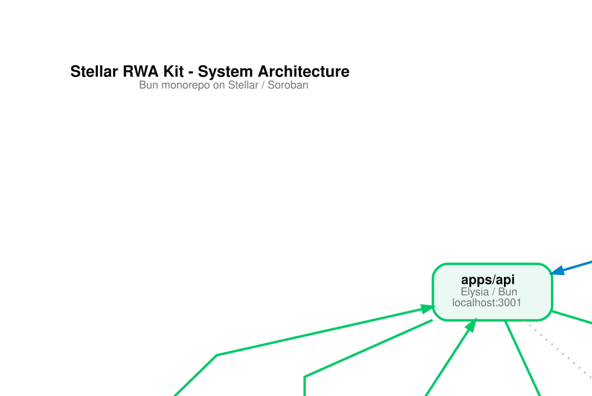
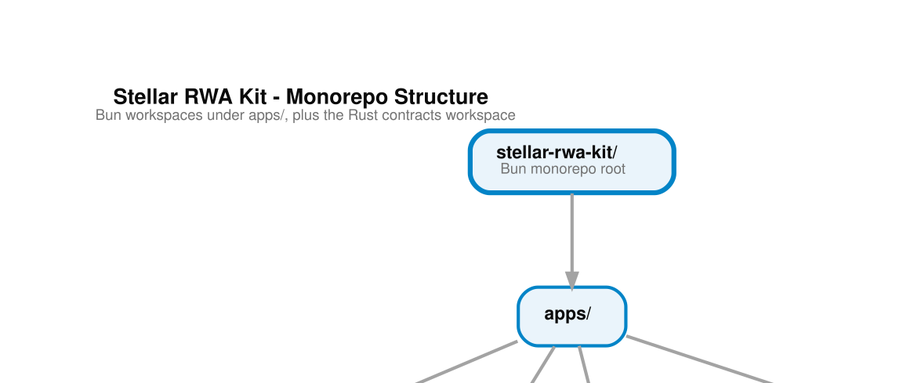

<div align="center">

# Stellar RWA Kit

**A starter kit for tokenizing real-world assets on Stellar and Soroban**

[](https://github.com/emilioszn/stellar-rwa-kit/actions/workflows/monorepo-ci.yml)
[](https://github.com/emilioszn/stellar-rwa-kit/actions/workflows/api-ci.yml)
[](https://github.com/emilioszn/stellar-rwa-kit/actions/workflows/webapp-ci.yml)
[](https://github.com/emilioszn/stellar-rwa-kit/actions/workflows/contracts-ci.yml)
[](LICENSE)

Working, tested Soroban contracts, a REST API, a Next.js frontend, and a shared TypeScript SDK for issuing income-participation tokens, distributing income on-chain, tokenizing assets into fractional shares, and lending against them.

[Overview](docs/overview.md) · [Getting Started](#getting-started) · [Architecture](#architecture) · [Tech Stack](#tech-stack) · [Contributing](CONTRIBUTING.md) · [Docs](docs/)

</div>

---

## Overview

**Read [`docs/overview.md`](docs/overview.md) first.** It describes each module, the trust model, and what to change before you build a product on top of the kit.

The kit has two independent contract systems:

- **Income distribution.** A whitelist, a non-transferable income-participation token, and a payout-split contract. An issuer submits each income cycle's evidence (a link plus a hash, recorded on-chain), an operator reviews it, and the contract deducts a platform fee and distributes the remainder pro-rata to holders in USDC, optionally EURC.
- **Asset tokenization and lending** (`defi-rwa`). Fractional share tokenization with contract-level KYC gating, plus a collateralized lending protocol with oracle valuation and liquidation.

Around them sit an API that holds the admin key and runs KYC and whitelist review, a webapp with investor, issuer, and operator dashboards, and an optional treasury integration with DeFindex and EtherFuse.

The kit was extracted from [Akkuea](https://github.com/akkuea/akkuea), a real estate tokenization project, so its examples use real estate. The full commit history and its contributors are preserved in this repository.

---

## Features

### Income distribution

- Income-participation token (SEP-41-style, fixed supply, non-transferable by default)
- On-chain investor whitelist backed by manual review in the API
- Evidence-gated payout cycles: submit, review, approve or reject with a reason, distribute
- Platform fee deducted on-chain before a pro-rata split, with USDC settlement and optional EURC via swap
- Dispute flagging, withheld-balance claims, pause, and two-step admin rotation

### Asset tokenization and lending

- Fractional share ownership of individual assets, tracked on-chain
- KYC/AML gating enforced at the contract level
- Role-gated minting and burning, with an immutable audit history
- Collateralized lending pools, interest accrual, oracle-based valuation, and liquidation

### Platform

- Wallet-based authentication via Stellar signatures, no passwords
- Role-based access control across admin, operator, and user tiers
- Webhook signature verification, rate limiting, input sanitization, and structured audit logging
- Optional treasury management through DeFindex (Blend strategy) and EtherFuse Stablebonds

---

## Architecture

```
┌──────────────────────────────────────────────────────────────────┐
│                         Stellar RWA Kit                          │
│                                                                  │
│  ┌─────────────────┐   ┌─────────────────┐   ┌───────────────┐  │
│  │   Web Frontend  │   │   Backend API   │   │Smart Contracts│  │
│  │  Next.js + React│◄──►│  Elysia / Bun  │◄──►│  Soroban/Rust │  │
│  │  localhost:3000 │   │  localhost:3001 │   │Stellar Network│  │
│  └────────┬────────┘   └────────┬────────┘   └───────────────┘  │
│           │                     │                                │
│           └──────────┬──────────┘                               │
│                      ▼                                           │
│            ┌──────────────────┐                                  │
│            │  Shared Library  │                                  │
│            │ Types · Utils    │                                  │
│            │ Validation · SDK │                                  │
│            └──────────────────┘                                  │
└──────────────────────────────────────────────────────────────────┘
```

The repository is a **Bun monorepo** with three `bun` workspaces, plus the Rust contracts workspace built separately:

| Workspace                         | Path             | Role                                                                    |
| --------------------------------- | ---------------- | ----------------------------------------------------------------------- |
| `@stellar-rwa-kit/webapp`         | `apps/webapp`    | Next.js 16 frontend with React 19                                       |
| `@stellar-rwa-kit/api`            | `apps/api`       | Elysia REST API running on Bun                                          |
| `@stellar-rwa-kit/shared`         | `apps/shared`    | Types, utilities, contract bindings, and Stellar SDK helpers            |
| Contracts (not a `bun` workspace) | `apps/contracts` | Soroban smart contracts in Rust: `defi-rwa` and the three `pilot-*` contracts |



### Data flows

**Income distribution cycle**

```
Issuer submits evidence (link + hash) → Operator reviews and approves
→ Payout-split contract deducts the fee → Remainder distributed pro-rata to holders
→ Dashboards read the cycle status from chain
```

**Property tokenization**

```
User submits property → Frontend validates → API verifies KYC
→ Soroban contract mints shares → Event emitted → API indexes
→ Frontend reflects updated portfolio
```

**Borrowing**

```
User requests loan → Frontend calculates available collateral
→ API checks on-chain share balance → Contract validates collateral ratio
→ Contract disburses funds → Frontend updates lending position
```

---

## Tech Stack

| Layer                  | Technology                                                      |
| ---------------------- | --------------------------------------------------------------- |
| **Frontend**           | Next.js 16, React 19, TypeScript, Tailwind CSS 4, Zustand, Zod  |
| **Backend API**        | Elysia, Bun runtime, TypeScript, Drizzle ORM, Zod               |
| **Database**           | PostgreSQL (Drizzle migrations), Redis (optional caching layer) |
| **Smart Contracts**    | Rust, Soroban SDK 26, WASM compilation target                   |
| **Blockchain**         | Stellar (Testnet / Mainnet), Horizon REST API, Soroban RPC      |
| **Wallet Integration** | `@creit.tech/stellar-wallets-kit`                               |
| **Testing**            | `bun test`, `@testing-library/react`, `cargo test`              |
| **CI/CD**              | GitHub Actions                                                  |
| **Tooling**            | Bun 1.4, ESLint 9, Prettier, Concurrently                       |

---

## Getting Started

### Prerequisites

- [Bun](https://bun.sh) 1.4 or later
- Docker (for PostgreSQL and Redis)
- Rust and the [Stellar CLI](https://developers.stellar.org/docs/tools/cli) (only to build or deploy contracts)

### Install

```bash
git clone https://github.com/emilioszn/stellar-rwa-kit.git
cd stellar-rwa-kit
bun install
```

### Run

```bash
# Copy environment variables
cp apps/api/.env.example apps/api/.env
cp apps/webapp/.env.example apps/webapp/.env.local

# Start services
docker compose -f docker-compose.dev.yml up -d

# Start the webapp and API
bun run dev
```

See [docs/local-setup.md](docs/local-setup.md) for full setup instructions.

> The testnet contract IDs in `apps/shared/src/contracts.testnet.json` point to deployments made by the original project. Deploy your own contracts (see [`docs/deployment/`](docs/deployment/)) and replace them before relying on them.

---

## Available Scripts

Run from the repository root:

| Script                     | Description                                    |
| -------------------------- | ---------------------------------------------- |
| `bun run dev`              | Start the webapp and API concurrently          |
| `bun run build`            | Build all workspaces                           |
| `bun run test`             | Run all workspace test suites                  |
| `bun run lint`             | Lint all workspaces                            |
| `bun run typecheck`        | Type-check all workspaces                      |
| `bun run format`           | Format all files with Prettier                 |
| `bun run clean`            | Remove all build artifacts and `node_modules`  |
| `bun run build:contracts`  | Build Soroban contracts via `scripts/build.sh` |
| `bun run deploy:contracts` | Deploy contracts via `scripts/deploy.sh`       |
| `make check`               | Run the same checks as pull-request CI         |

---

## Environment Variables

All required environment variables are documented in [`docs/deployment/environment-variables.md`](docs/deployment/environment-variables.md). For step-by-step instructions on obtaining values for local development, see [`docs/ENV_SETUP.md`](docs/ENV_SETUP.md). The source of truth for variables is `apps/api/.env.example`.

Key categories:

- **Database**: PostgreSQL connection string and pool settings
- **API Server**: port, environment, log level
- **Security**: webhook secret, operations credential, allowed admin wallets
- **Stellar / Soroban**: Horizon URL, RPC URL, network passphrase, admin keypair, contract IDs
- **KYC**: upload directory for compliance documents

> **Security note:** Never commit `.env` files. `STELLAR_ADMIN_SECRET` is a root credential. Treat it like a private key and load it from a secrets manager in production.

---

## CI/CD

GitHub Actions workflows run on every push and pull request to `main` and `develop`:

| Workflow  | File               | Checks                                                                                                |
| --------- | ------------------ | ----------------------------------------------------------------------------------------------------- |
| Monorepo  | `monorepo-ci.yml`  | Workspace integrity, dependency audit, bundle sizes, cross-workspace integration, security compliance |
| API       | `api-ci.yml`       | Lint, type-check, unit tests, build                                                                   |
| Webapp    | `webapp-ci.yml`    | Lint, type-check, unit tests, build                                                                   |
| Shared    | `shared-ci.yml`    | Lint, type-check, build                                                                               |
| Contracts | `contracts-ci.yml` | Rust format, Clippy, unit tests, WASM build                                                           |
| Pilot E2E | `pilot-e2e.yml`    | End-to-end income distribution lifecycle against the API                                              |

All workflows must pass before a pull request can be merged. Run `make check` locally to catch failures first.

---

## Project Structure

```
stellar-rwa-kit/
├── apps/
│   ├── api/              # Elysia/Bun backend API
│   │   ├── src/
│   │   │   ├── controllers/
│   │   │   ├── services/
│   │   │   ├── repositories/
│   │   │   ├── routes/
│   │   │   ├── middleware/
│   │   │   ├── db/
│   │   │   └── workers/
│   │   └── drizzle/      # Database migrations
│   ├── webapp/           # Next.js frontend
│   │   └── src/
│   │       ├── app/      # App Router pages and layouts
│   │       ├── components/
│   │       ├── hooks/
│   │       ├── services/
│   │       └── types/
│   ├── contracts/        # Soroban smart contracts (Rust)
│   │   └── contracts/
│   │       ├── defi-rwa/            # Fractional shares + lending
│   │       ├── pilot-whitelist/     # Investor whitelist
│   │       ├── pilot-income-token/  # Income-participation token
│   │       └── pilot-payout-split/  # Evidence-gated income distribution
│   └── shared/           # Shared TypeScript library
├── docs/
│   ├── overview.md       # Start here
│   ├── decisions/        # Design history and integration verification
│   ├── design-system/    # Visual and interaction system
│   ├── api/              # API endpoint documentation
│   ├── architecture/     # System design documents
│   ├── deployment/       # Deployment and environment guides
│   ├── operations/       # Runbooks for production operations
│   └── testing/          # Testing strategy and smoke tests
├── scripts/              # Build, check, and deployment scripts
└── .github/
    └── workflows/        # GitHub Actions CI definitions
```



---

## Documentation

| Document                                                                               | Description                                    |
| -------------------------------------------------------------------------------------- | ---------------------------------------------- |
| [`docs/overview.md`](docs/overview.md)                                                 | Modules, trust model, and what to adapt        |
| [`docs/decisions/decision-log.md`](docs/decisions/decision-log.md)                     | Why the main design choices were made          |
| [`docs/design-system/README.md`](docs/design-system/README.md)                         | Visual and interaction system                  |
| [`docs/local-setup.md`](docs/local-setup.md)                                           | Full local setup walkthrough                   |
| [`docs/ENV_SETUP.md`](docs/ENV_SETUP.md)                                               | Local environment variable setup guide         |
| [`docs/architecture/system-architecture.md`](docs/architecture/system-architecture.md) | System design and component breakdown          |
| [`docs/deployment/environment-variables.md`](docs/deployment/environment-variables.md) | Complete environment variable reference        |
| [`docs/deployment/deploy-pilot-contracts.md`](docs/deployment/deploy-pilot-contracts.md) | Income distribution contract deployment        |
| [`docs/deployment/deploy-contracts.md`](docs/deployment/deploy-contracts.md)           | `defi-rwa` contract deployment                 |
| [`docs/api/overview.md`](docs/api/overview.md)                                         | API overview and authentication                |
| [`docs/api/minting-workflow.md`](docs/api/minting-workflow.md)                         | Property tokenization API flow                 |
| [`docs/api/kyc-workflow.md`](docs/api/kyc-workflow.md)                                 | KYC verification API flow                      |
| [`CONTRIBUTING.md`](CONTRIBUTING.md)                                                   | Contribution workflow and standards            |

---

## Contributing

Contributions are welcome through a fork and pull request against `develop`. Read **[CONTRIBUTING.md](CONTRIBUTING.md)** before opening your first pull request.

---

## License

[MIT](LICENSE). Original work copyright Acachete Labs (Akkuea); see [`LICENSE`](LICENSE) for the full notice.
