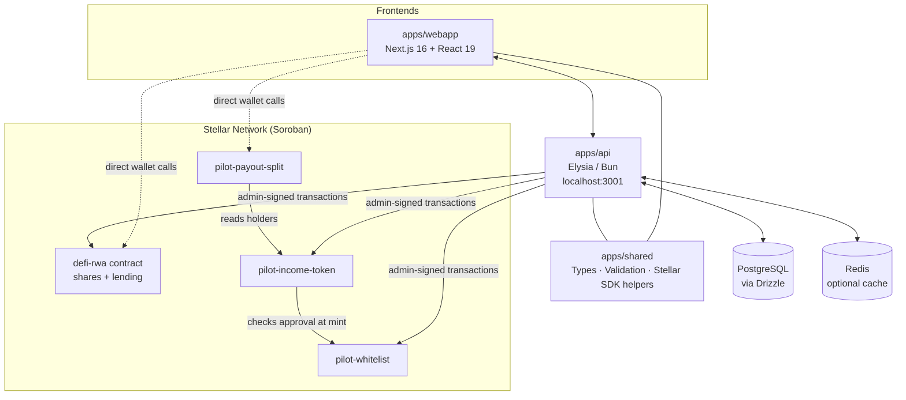
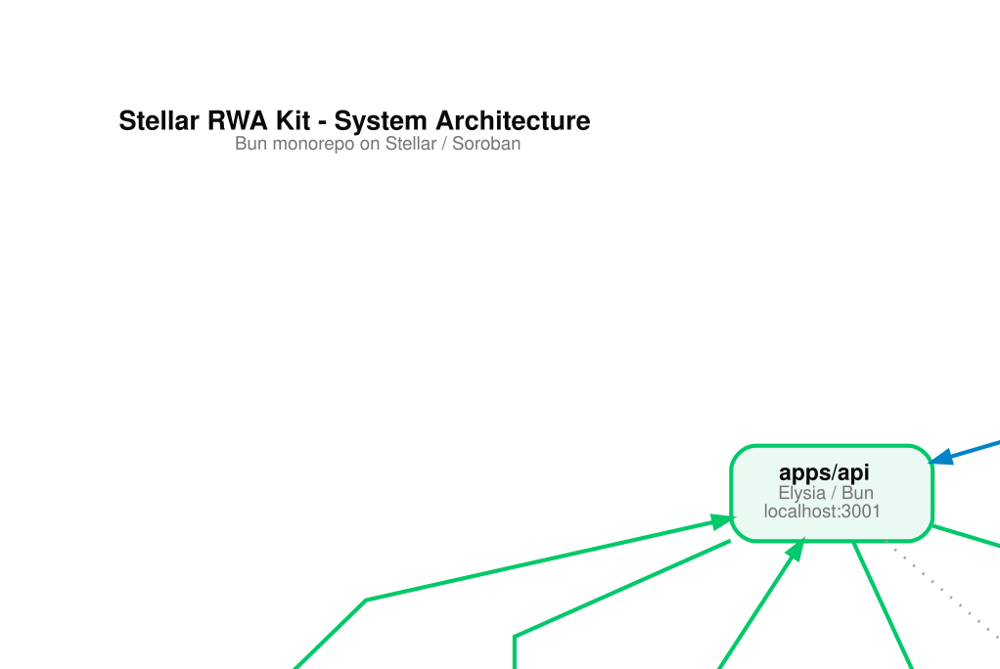
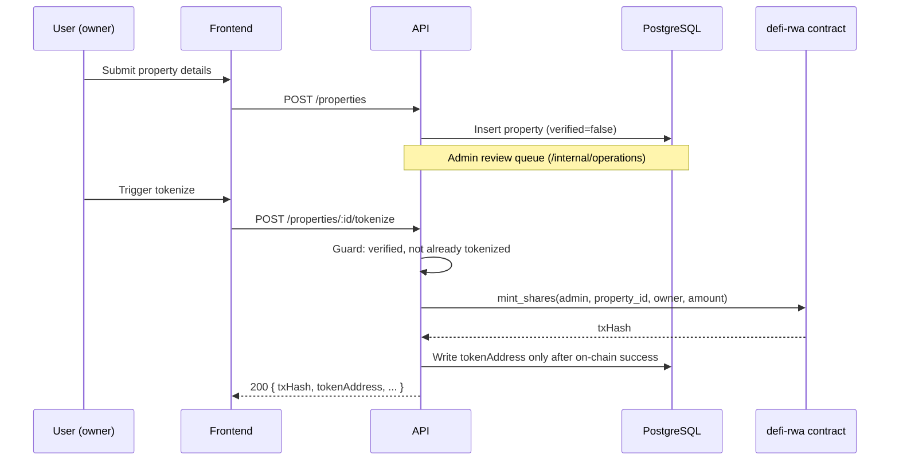
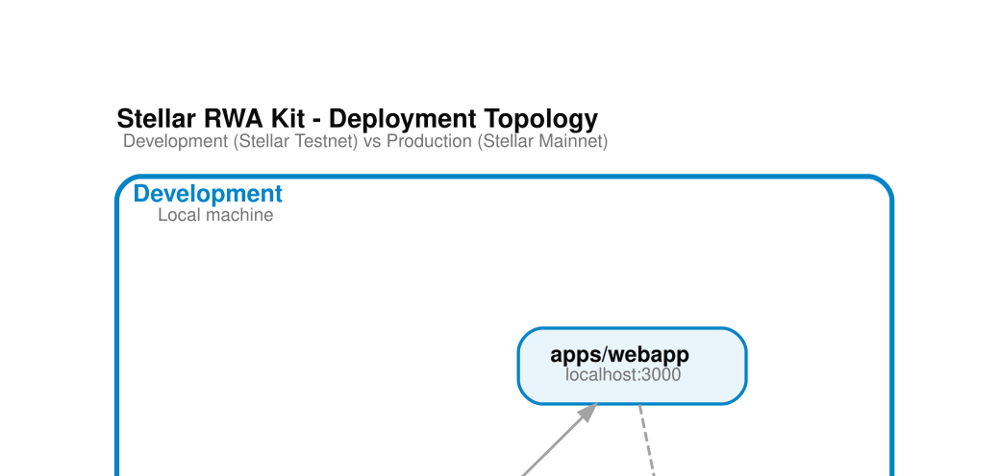

# System Architecture

> For what each module is for and what to adapt, start with [`../overview.md`](../overview.md). This document describes how the pieces fit together.

## Overview

Stellar RWA Kit is a Bun monorepo with four applications working together: one Next.js frontend, one Elysia/Bun API, one shared TypeScript library, and one Rust/Soroban contracts workspace containing two independent contract systems.

## High-Level Architecture



Presentation version (vertical, generated by [`scripts/diagrams/`](../../scripts/diagrams/)):



The webapp talks to the API and shares the same `@stellar-rwa-kit/shared` types with it, and also talks to the contracts directly from the browser via a connected Stellar wallet (Freighter or equivalent) for user-signed actions, while the API holds the admin key for admin-signed actions (minting, oracle configuration, role grants).

## Component Breakdown

### 1. Web Application (`apps/webapp`)

**Technology Stack:** Next.js 16 (App Router), React 19, TypeScript, Tailwind CSS 4, `@stellar/stellar-sdk`, `@creit.tech/stellar-wallets-kit`.

**Responsibilities:** property browsing and tokenization UI, wallet connection, share purchase, lending pool interactions, KYC document upload, portfolio management, treasury view, and the income distribution dashboards (investor, issuer, whitelist review, evidence review). See [`../design-system/`](../design-system/) for the visual system this app implements.

### 2. Backend API (`apps/api`)

**Technology Stack:** Elysia (Bun runtime), TypeScript, Drizzle ORM (PostgreSQL), Zod validation, Swagger-generated docs.

**Responsibilities:** REST API for the webapp, admin-signed blockchain transaction orchestration, KYC and whitelist review workflows, income evidence reads and escalation jobs, treasury operations, property review queue, notifications, rate limiting and structured audit logging. See [`../api/overview.md`](../api/overview.md).

### 3. Smart Contracts (`apps/contracts`): two independent systems

**Technology Stack:** Rust, Soroban SDK, WASM (`wasm32v1-none` target via `stellar contract build`).

Two separate, unrelated contract systems live in this one Rust workspace:

- **Income distribution** (`pilot-whitelist`, `pilot-income-token`, `pilot-payout-split`): three independently deployed contracts. The whitelist gates who may hold the token, the token records a fixed supply across approved holders, and the payout split records evidence per cycle and distributes income pro-rata after a platform fee. See [`../deployment/deploy-pilot-contracts.md`](../deployment/deploy-pilot-contracts.md).
- **`defi-rwa`**: single WASM binary exposing both property-share tokenization and DeFi lending (pools, collateral, oracle-based valuation, liquidation, emergency pause). See [`../deployment/deploy-contracts.md`](../deployment/deploy-contracts.md).

### 4. Shared Library (`apps/shared`)

**Technology Stack:** TypeScript.

**Responsibilities:** type definitions shared between the webapp and the API, Stellar utilities, validation schemas, contract bindings, contract-ID resolution (`contracts.testnet.json` / `contracts.mainnet.json`), test factories and staging scenarios (see [`../testing/smoke-tests.md`](../testing/smoke-tests.md)).

## Data Flow Architecture

### Property Tokenization Flow



Full detail: [`../api/minting-workflow.md`](../api/minting-workflow.md).

### DeFi Borrowing Flow

```
User requests loan → Frontend calculates available collateral
→ API checks on-chain share balance → Contract validates collateral ratio via oracle
→ Contract disburses funds → Frontend updates lending position
```

### Income Distribution Flow

```
Issuer submits evidence (link + hash) to pilot-payout-split → Operator starts review
→ Operator approves (or rejects with a reason) → Operator executes the distribution
→ Contract deducts the platform fee and pays holders pro-rata → Dashboards read the cycle status from chain
```

Full detail: [`../deployment/deploy-pilot-contracts.md`](../deployment/deploy-pilot-contracts.md).

## Security Architecture

### 1. Authentication & Authorization

- Wallet-based authentication using Stellar Ed25519 signatures (see [`../api/authentication.md`](../api/authentication.md))
- Role-based access control on-chain for `defi-rwa` (`Admin`, `Pauser`, `EmergencyGuard`, plus reserved-but-unenforced `Oracle`/`Verifier`/`Liquidator` roles - see [`../operations/runbook-role-management.md`](../operations/runbook-role-management.md))
- Off-chain KYC state machine gating platform participation (see [`../api/kyc-workflow.md`](../api/kyc-workflow.md) for known enforcement gaps)
- Rate limiting on authentication and general API endpoints

### 2. Smart Contract Security

- Role-gated admin functions, two-step admin transfer (`transfer_admin_start` / `transfer_admin_accept`)
- 24-hour timelocked emergency pause and recovery (see [`../operations/runbook-emergency-pause.md`](../operations/runbook-emergency-pause.md))
- Configurable oracle staleness/price-floor guardrails (see [`../operations/runbook-oracle-failure.md`](../operations/runbook-oracle-failure.md))
- Event logging on-chain for audit trails

### 3. API Security

- CORS configuration scoped to known frontend origins
- Input validation and sanitization
- Admin-only endpoints gated by `OPERATIONS_BACKEND_CREDENTIAL` / `OPERATIONS_ALLOWED_WALLETS` (see [`../deployment/environment-variables.md`](../deployment/environment-variables.md))
- Secrets never committed - `STELLAR_ADMIN_SECRET` treated as a root credential

## Deployment Architecture

### Development

```
Local Machine:
├── apps/webapp    (localhost:3000)
├── apps/api       (localhost:3001)
├── PostgreSQL + Redis (docker-compose.dev.yml)
└── Stellar Testnet
```

### Production

```
├── Webapp          (static/edge hosting)
├── API             (load-balanced Elysia/Bun)
├── Database        (managed PostgreSQL)
├── Redis           (optional cache layer)
└── Stellar Mainnet (defi-rwa + income distribution contracts, deployed independently)
```



See [`../deployment/deploy-contracts.md`](../deployment/deploy-contracts.md), [`../deployment/deploy-pilot-contracts.md`](../deployment/deploy-pilot-contracts.md), and [`../deployment/post-deploy-checklist.md`](../deployment/post-deploy-checklist.md).

## Integration Points

### External

1. **Stellar Network** - Horizon (classic ops) and Soroban RPC (contract invocations)
2. **SEP-40 price oracle** - required by `defi-rwa` for lending; see [`../operations/runbook-oracle-failure.md`](../operations/runbook-oracle-failure.md)
3. **KYC document review** - currently manual/admin-driven, no third-party KYC provider integrated (see [`../api/kyc-workflow.md`](../api/kyc-workflow.md))

### Internal

1. **`@stellar-rwa-kit/shared`** - types and utilities shared across the TypeScript workspaces
2. **`@stellar/stellar-sdk`** - all frontend and API components talk to Stellar through this
3. **Drizzle ORM models** - API ↔ PostgreSQL
4. **Contract-ID JSON artifacts** (`apps/shared/src/contracts*.json`) - the single source of truth read by both the API and the webapp for which contract to call, per network

## See also

- [`../overview.md`](../overview.md): modules and what to adapt
- [`../decisions/decision-log.md`](../decisions/decision-log.md): why the income distribution contracts are separate from `defi-rwa`
- [`../design-system/`](../design-system/) - the visual/interaction system `apps/webapp` implements
- [`../deployment/`](../deployment/) - deployment guides for both contract systems
