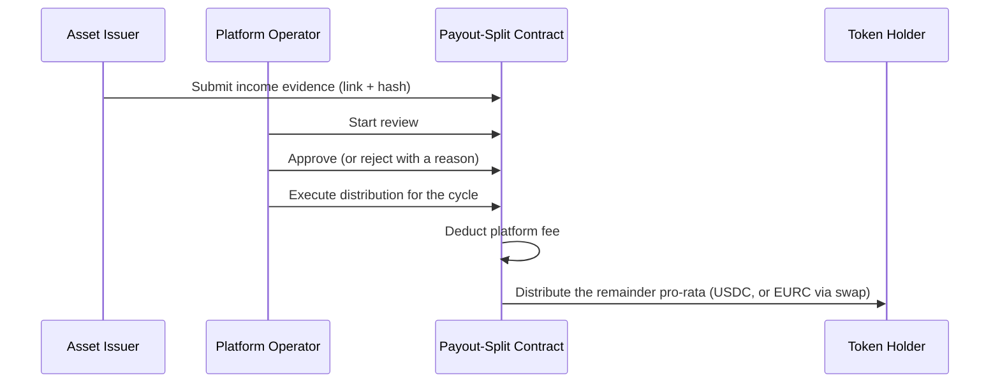
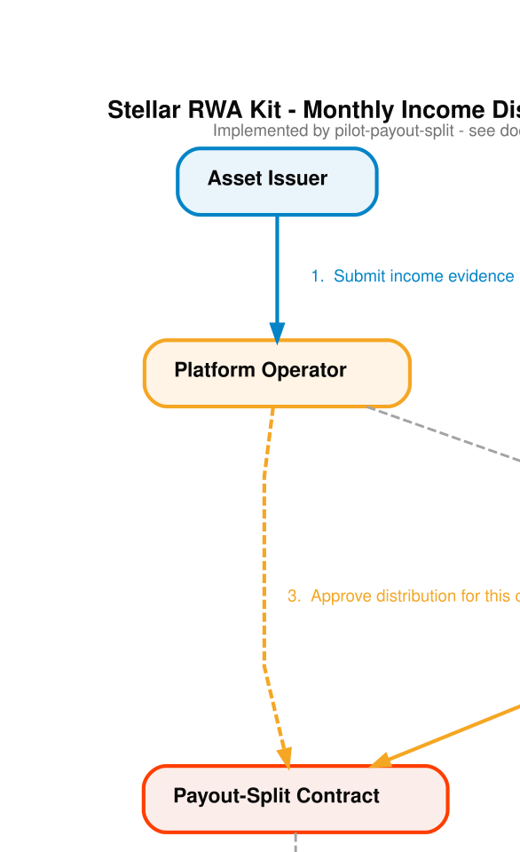

# Stellar RWA Kit: Overview

Stellar RWA Kit is a starter kit for tokenizing real-world assets on Stellar with Soroban smart contracts. It gives you working, tested building blocks (contracts, a REST API, a web frontend, and a shared TypeScript SDK) that you adapt to your own asset, jurisdiction, and business model rather than writing from an empty repository.

The kit was extracted from Akkuea, a real estate tokenization project, so its examples and default copy use real estate. The contracts and services themselves are not real-estate specific: any asset that produces income, or that can be split into shares, fits the same patterns.

This document is the starting point for product and architecture decisions. Where another file in this repository describes the system differently, this overview wins.

---

## What is in the kit

The kit contains two independent contract systems plus the off-chain services that operate them. You can use either system on its own or both together.

### 1. Income distribution module

Issue a token that represents a right to a share of an asset's income, and distribute that income to holders on-chain, backed by reviewed evidence.

| Contract             | Path                                         | What it does                                                                                                                                                                     |
| -------------------- | -------------------------------------------- | -------------------------------------------------------------------------------------------------------------------------------------------------------------------------------- |
| `pilot-whitelist`    | `apps/contracts/contracts/pilot-whitelist`    | On-chain approved/not-approved list of investor addresses, backed by manual identity review in the API.                                                                          |
| `pilot-income-token` | `apps/contracts/contracts/pilot-income-token` | SEP-41-style income-participation token with a fixed supply, minted only to whitelisted holders. Non-transferable by default.                                                    |
| `pilot-payout-split` | `apps/contracts/contracts/pilot-payout-split` | Records each income cycle's evidence (link plus hash), runs a submit, review, approve flow, deducts a platform fee, and distributes the rest pro-rata in USDC (optionally EURC). |

The contracts keep the `pilot-` prefix from the project they came from. They are general-purpose: rename them when you fork the kit if the prefix does not fit your product.

Trust model: income evidence is reviewed by a person and referenced on-chain as a link plus a cryptographic hash. The distribution itself is enforced by the contract. Describe the result as verifiable and auditable, not as "trustless".

Presentation version (generated by [`scripts/diagrams/`](../scripts/diagrams/)):

Deployment guide: [`deployment/deploy-pilot-contracts.md`](deployment/deploy-pilot-contracts.md). Operations: the `pilot-*` runbooks under [`operations/`](operations/).

### 2. Asset tokenization and lending module

A single larger contract, `defi-rwa`, that covers fractional share tokenization and a collateralized lending protocol.

- Fractional share ownership of individual assets, tracked on-chain
- KYC gating enforced at the contract level, with role-gated minting and burning
- Lending pools that accept tokenized shares as collateral
- Interest accrual, oracle-based valuation, and liquidation

Deployment guide: [`deployment/deploy-contracts.md`](deployment/deploy-contracts.md). API flows: [`api/`](api/).

### 3. Treasury integration (optional)

The API can move idle platform funds into already-audited yield venues: a DeFindex vault using the Blend strategy, and EtherFuse Stablebonds. See [`operations/runbook-treasury-track.md`](operations/runbook-treasury-track.md) and [`decisions/integration-decisions.md`](decisions/integration-decisions.md) for how each venue was verified.

### Off-chain services

| Path          | Role                                                                                                                                                     |
| ------------- | -------------------------------------------------------------------------------------------------------------------------------------------------------- |
| `apps/api`    | Elysia REST API on Bun. Holds the admin key for admin-signed actions (minting, oracle configuration, role grants) and runs KYC and whitelist review.      |
| `apps/webapp` | Next.js frontend: marketplace, portfolio, lending, tokenization, KYC, and the income-distribution dashboards for investors, issuers, and operators.        |
| `apps/shared` | `@stellar-rwa-kit/shared`: types, validation, Stellar SDK helpers, contract bindings, contract-ID resolution, and test factories used by the API and webapp. |

Full breakdown: [`architecture/system-architecture.md`](architecture/system-architecture.md).

---

## Adapting the kit

Things you will almost certainly change before going to production:

- **Branding.** Product name, logo (`apps/webapp/public/logo.png`), and copy in `apps/webapp/messages/`.
- **Platform fee.** The payout-split contract deducts a fixed 10% per distributed cycle. Change it in `apps/contracts/contracts/pilot-payout-split/src/lib.rs` and update the tests that assert it.
- **Transferability.** The income token is non-transferable by design, which avoids holder-snapshot logic. If you need a secondary market, you also need snapshotting in the payout split.
- **Compliance.** The whitelist is a minimum-defensible approve/revoke list, not a compliance engine. Check what your jurisdiction requires before onboarding real investors.
- **Legal classification.** Whether an income-participation token is a security depends on jurisdiction. Get legal advice before issuing one.
- **Contract IDs.** Deployed IDs live in `apps/shared/src/contracts.testnet.json` and `apps/shared/src/contracts.mainnet.json`. The testnet IDs in this repository point to the original project's deployments; deploy your own and replace them.

## Design history

The reasoning behind the main design choices (non-transferable token, evidence as link plus hash, fee placement, which third-party integrations were adopted or rejected) is recorded in [`decisions/decision-log.md`](decisions/decision-log.md) and [`decisions/integration-decisions.md`](decisions/integration-decisions.md). Those records were written for the original Akkuea pilot and are kept because the trade-offs still apply to anyone building on this kit.
